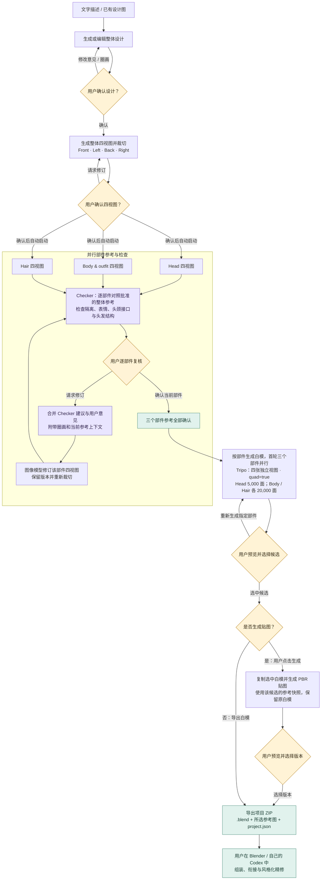

# Agentic 3D Asset Factory

我做的一个 AI 角色资产制作工具，将文字描述或设计图逐步转化为可在 Blender 中继续编辑的 3D 角色资产。

项目把整体设计、四视图、部件参考、AI 检查、三维生成和导出串在同一个工作流里。角色按 **Head、Body & outfit、Hair** 三个部件独立生成，支持局部修改、候选选择和版本追溯，最终交付原生 `.blend` 项目与对应参考图。

**目前已跑通真实图片生成、三部件建模、贴图、浏览器预览和 Blender 项目导出的完整链路，仍在持续迭代。** 导出的部件可继续组装和精修；自动组装、骨骼绑定与动画制作尚未包含在应用中。

## 为什么做这个项目

我希望把角色生成做成一个可以反复修改、保留设计意图并继续制作的过程。直接生成完整角色时，脸部、发型和服装可能偏离参考；局部不满意时，重新生成整个角色也容易影响已经满意的部分。手动串联图像生成、3D 服务和 Blender，还需要反复整理参考图、模型和版本。

这个项目围绕三个方向展开：

- **将设计拆成可独立迭代的部件**：分别准备头部、身体与服装、头发的四视图，允许针对局部问题重新生成。
- **将视觉问题转成修改建议**：Checker 对照整体设计与部件参考，定位隔离、表情、头颈接口及设计偏移等问题，并将建议加入用户发起的修订。
- **让生成结果能接着做下去**：保留原始资产、参考版本与模型输入快照，导出带贴图的 Blender 项目，方便后续组装和精修。

## 核心功能

| 功能 | 当前能力 |
|---|---|
| 角色设计 | 从文字或已有设计图开始，支持上传参考、圈画和文字反馈 |
| 多视角参考 | 生成整体及部件四视图，按 Front、Left、Back、Right 裁切 |
| AI 视觉检查 | 对照批准的整体参考，输出部件问题、严重程度和修订建议 |
| 分件建模 | 并行生成三部件白模，逐部件预览、重试和选择候选 |
| 独立贴图 | 对选中白模的副本生成 PBR 贴图，保留原始几何版本 |
| 版本管理 | 保存历史参考与模型，上游修改后标记下游版本需要更新 |
| Blender 交付 | 导出完整项目或单部件 `.blend`，打包贴图与所选参考 |

## 制作案例

### Jinx：从设计参考到 Blender 资产

已完成真实参考生成、三部件白模、贴图、浏览器预览与原生 `.blend` 项目导出，并通过后台 Blender 重新打开检查。

[查看分件生成、装配与整体生成对照](docs/JINX_EXPERIMENT.md)，包含设计、四视图、三部件交付、全身装配、脸部与背面对照，以及 Blender 局部修复记录。

当前案例中，分件生成呈现出更明确的脸部细节，也暴露了头部与身体风格不协调、头颈接口需要手动处理、局部纹理不够清晰等问题。分件方案同时使用了更充分的局部参考和更高的累计生成预算，现有结果尚不足以证明总体质量或 Checker 的独立增益。

### 二次元角色：下游精修与舞台展示

`v2_soft_anime_trial.blend` 案例在应用生成资产的基础上，经外部 Blender/Codex 辅助与人工处理，进一步完成精修、绑定和动作适配，并进入包含 MMD Motion System 的舞台场景。这一案例展示了资产交付后继续制作的可能；相关绑定与动画处理属于下游制作过程。

现有使用记录中，简单组装约需 **3–5 分钟操作时间**，有人监督的 Codex 辅助组装约需 **10 分钟**。这些是单次案例估计，不包含参考生成、三维生成、完整精修、绑定和动画制作。

## 交付范围

交付终点是 **可打开的 Blender 资产和所选版本的参考图**。三个部件放入同一个场景，保留生成时的位置和尺度；比例、位置、颈部衔接和穿插仍需在 Blender 中调整。

我将后续开发重点放在参考一致性、部件质量、反馈效率与可靠交付上。用户可以用 Blender 基础操作完成组装，也可以在自己的 Codex 中打开解压后的项目文件夹继续调整。Codex 辅助精修仍需人工检查关键步骤，发现错误时及时回退。

## 当前工作流

下面展示当前已实现的流程。Checker 对每个新生成的部件参考进行视觉检查；是否修订、是否接受由用户决定。



**循环中的职责**：Checker 负责识别问题并提出修订建议；系统把建议与用户意见加入下一轮图像生成；用户控制修订调用和参考批准。检查结果不会自行触发付费重生成，用户也可以复核后接受当前版本。当前 Checker 检查的是部件参考图，3D 候选与贴图由用户预览和选择。生成新版本会保留历史，上游变更会将相关下游结果标记为待更新。

### Agentic 能力：主动检查、修订决策与设计一致性

Agent 的价值是把“发现问题 → 判断如何处理 → 形成修改提示词 → 检查修改结果”连接起来，帮助用户将语言设计逐步落实为可用的三维参考。下一步重点加强以下两个环节；它们具有不同的决策边界。

**1. 四视图的有限自主检查与修订（计划增加）。** 整体四视图生成后，由 Agent 对照已确认的设计主动检查：背景和视图是否干净，是否有文字、水印或无关内容，角色是否完整，朝向及排列是否正确，以及不同视角的比例、服装和身份是否一致。部件四视图还应检查是否残留不属于该部件的内容、是否满足头颈接口等隔离要求。这里的“干净”指参考图是否适合后续裁切与三维生成。

对明确影响建模输入的问题，Agent 生成针对性的修订 prompt，并在用户启用自动修订后自行决定是否执行下一轮生成。拟支持最多 2–3 轮“检查 → 修订生成 → 再检查”，上限可配置，初始生成不计入修订轮数；达到要求则提前停止，达到上限或无法可靠判断则展示现有版本、问题和处理建议，交给用户决定。这个闭环的目标是减少用户逐轮指出基础输入问题的负担，而不是用满所有轮次。

**2. 拆件后的设计语义一致性检查（已有基础，计划加强）。** 拆分后，头部可能变得不像原角色，发型、服装或局部比例也可能偏离整体设计。Agent 同时检查“已确认的整体参考图”和“当前部件参考图”，定位身份、轮廓、配色、装饰及风格的具体偏差，并提出修改建议，形成可用于下一轮生成的修订 prompt。用户可以查看依据、编辑建议，并自行决定是否重新生成该部件，保留满意的其他部件。

当前代码已支持部件图与整体参考的双图检查，输出视角、问题严重程度和修改建议；用户发起修订时，系统将这些建议加入生成 prompt。下一步加强设计语义偏移的检查规则，并将修订 prompt 明确展示给用户，便于确认和编辑。当前检查对象仍是二维参考图；组装后的 3D 角色是否保持整体设计，需要通过渲染视图或实际模型另外评价。

**实现状态**：当前没有整体四视图的自动检查—重生成闭环，也没有自主执行 2–3 轮修订。上述第一项属于开发计划；第二项的双图检查和建议融入修订已实现，独立可编辑的建议 prompt 展示仍属计划。自动修订处理明确的参考输入问题，涉及角色身份、风格和审美的取舍继续由用户确认。

1. **整体设计**：文字生成或已有图像生成；设计描述选填。上传参考图、圈画问题并填写修改意见。
2. **整体四视图**：确认整体设计后自动生成 Front / Left / Back / Right。要求适合后续建模的初始站姿、适当腿间距；自动裁切后由用户检查。
3. **并行部件参考**：确认整体四视图后，并行生成 Head、Body & outfit、Hair 的四视图。每个部件继承整体参考，并单独检查、修改和确认。
4. **AI 结构检查**：检查部件隔离、表情一致性、头颈接口、头发残留脸/耳朵和刘海走线等。用户生成修订版时会结合检查建议与自己的意见。检查是辅助判断，不会自动无限重试。
5. **并行白模生成**：三个部件参考全部确认后，分别上传四张独立视图到 Tripo，先生成无材质模型。可逐部件旋转查看、比较候选或重新生成。
6. **可选贴图**：对选中的白模点击 Generate texture。系统复制原白模，在副本上生成贴图，并使用该候选的四视图输入；原白模和已有结果保留。提交贴图后原白模仍可生成新的几何候选。
7. **项目导出**：选择各部件的候选版本，输出 `项目名.zip`。解压后直接打开 `.blend`，或把整个文件夹交给用户自己的 Codex。

左侧按整体设计 → 四视图 → 并行部件 → 3D 解锁；已完成步骤可以返回。上游变更会使相关下游结果标记为待更新。参考和模型版本保留在应用内，**项目交付包不包含历史消息或全部历史图片**。

## 项目交付包

例如 Jinx 项目：

```text
Jinx.zip
├── Jinx.blend
├── references/
│   ├── design.png
│   ├── turnaround.png
│   ├── head.png
│   ├── body.png
│   ├── hair.png
│   └── views/
│       ├── turnaround/{front,left,back,right}.png
│       ├── head/{front,left,back,right}.png
│       ├── body/{front,left,back,right}.png
│       └── hair/{front,left,back,right}.png
├── project.json
└── README.md
```

`.blend` 内包含选中的三个部件与已生成的贴图。参考图只包含所选模型对应的版本；部件裁切图使用该候选实际提交的不可变输入快照。`project.json` 记录所选模型和参考图的对应关系，不导出编辑消息、AI 检查历史或密钥。

**Export component** 单独下载 `项目名_head.blend`、`项目名_body.blend` 或 `项目名_hair.blend`。白模也可导出，贴图和最终确认不是导出的前提。

导出服务后台运行 Blender、打包纹理并保存真实 `.blend`；用户无需再运行导入脚本。保存窗口在支持的浏览器中可选择位置，其他浏览器使用默认下载方式。旧的模型＋导入脚本 ZIP 接口仅保留兼容用途，不是当前项目导出按钮的交付形式。

## 技术设计与 Agent 的职责

- **OpenAI 图片服务**：整体设计、四视图和部件参考的生成与修订。
- **视觉检查模型**：结合部件图与整体参考输出结构问题建议。当前默认配置为 `gpt-5-mini`，可通过 `OPENAI_REVIEW_MODEL` 更改。
- **项目上下文**：保存角色身份、当前批准参考、依赖、反馈及不可变模型输入快照，避免把不同版本混在一起。
- **Tripo P2.0**：当前几何配置为 `P2-20260801`；输入顺序为 front、left、back、right，四张图分别上传，不把四宫格当作单张输入。
- **几何与材质分离**：始终请求 `quad=true`；Head 目标 5,000 面，Body/Hair 各 20,000 面。这些是请求设置，实际面数及四边形比例需要检查原始文件。
- **贴图**：使用独立纹理模型 `v3.5-20260815`、`detailed` 和 PBR。4K 是目标；当前 Jinx 实测为 4096×4096，不代表未来每次输出都保证该分辨率。
- **预览与导出**：Three.js 提供白模、原始材质、双面显示和线框。网页渲染会三角化，不能据此判定原始 FBX 的四边形拓扑。Blender 在服务端生成并缓存可携带贴图的场景文件。

Agent 能力主要体现在对照整体与部件参考进行结构和设计一致性判断，并把判断转成下一轮修订要求。下一步将加入四视图基础质量的有限自主检查与修订，使 Agent 能在明确范围内决定下一步行动。并行调度、裁切、状态管理和打包属于工程自动化。当前是 **人工参与的 AI 工作流**，不是自主完成建模、组装和绑定的通用 Agent。核心贡献是从语言设计到可编辑三维角色的可用工作流与可追溯交付，而不是训练新的生成模型。

## 计划中的 baseline 与评估

以下是待执行实验，尚无已完成的对照结果。研究问题是：**把角色拆成部件生成，是否比整体一次生成更贴近参考、更少结构问题，并更方便后续编辑？**

| 方案 | 输入与流程 | 要检验的内容 |
|---|---|---|
| Baseline：整体直接生成 | 同一组批准的整体四视图，裁成四张独立图片，直接调用 Tripo 生成完整角色 | 现有生成服务的直接使用效果 |
| 本项目：部件生成 | 从同一整体四视图生成部件参考，分别生成 Head、Body、Hair，导出同一 Blender 场景 | 部件拆分、参考管理和工作流的总体价值 |
| 补充消融：无 AI 检查 | 使用同样的部件流程，但不向修订加入 AI 结构检查建议 | AI 检查能否改善结果或减少人工反馈 |

### 公平比较规则

- 固定相同角色设计、整体四视图、Tripo 几何版本和四边形要求。双方都按接口要求上传四张独立图，不能让 baseline 只使用一张四宫格。
- 区分两类证据：先检查生成原始输出，再比较经过相同人工修整时间或相同外部 Codex 预算后的结果。部件方案的组装与精修也必须计入。
- 报告图片、视觉检查、几何、贴图及重试的全部调用成本，同时记录人工时间、等待时间、候选数量和成功率。
- 部件方案的总目标面数为 45,000。整体模型的可用面数受对应 API 限制；报告双方请求和实际面数，不能默认它们相同。能在接口限制内实现预算匹配时，再做额外控制实验。
- 主实验允许工作流投入不同，但结论应表达为质量／编辑便利性与额外成本的权衡，不能据此声称同成本必然更好。
- 首轮计划使用 3–5 个不同复杂度的角色；预算允许时重复生成，避免只展示一个最好的随机结果。保留失败案例，不把小样本结果包装成普遍结论。

### 建议指标

1. **参考一致性**：脸、发型、服装、配色及多个视角的一致性。预先制定评分标准，由不知方案标签的评审评分。
2. **结构问题**：缺失、粘连、穿插、头发残留解剖结构及头颈衔接问题；图片检查和真实模型检查分开记录。
3. **可编辑性**：完成头发替换、头部调整等指定任务的耗时、操作数和影响范围。
4. **交付可靠性**：项目包能否解压，`.blend` 能否打开，贴图是否嵌入，模型与参考版本是否一致。
5. **成本与效率**：每角色实际费用、重试次数、人工修整时间和端到端等待时间。

直接生成对照主要检验部件策略，不单独证明 Agent 的增益。无 AI 检查的消融用于检验判断环节。自动测试用于检查软件行为，也不能替代上述资产效果评估。

## 后续开发方向

按优先级推进，先验证价值，再扩大范围：

1. **完善案例与对照验证**：补充整体生成对照、失败记录、实际费用与组装时间统计，整理可复现的完整流程。
2. **加强 Agent 检查与决策**：增加整体四视图的干净程度、多视角一致性检查，以及最多 2–3 轮的自主检查—修订闭环；加强部件与整体参考的设计语义比较，展示可编辑的修订 prompt，由用户决定语义与风格修订。
3. **拆清数据与服务边界**：把项目记忆、图片生成、视觉检查、模型生成、预览和导出进一步模块化，整理明确的版本依赖与测试。
4. **改进参考与接口一致性**：检查四视图比例、表情、颈部截面和头发隔离；降低拼接时需要的手动调整。
5. **评价检查与修订效果**：对照人工判断评价漏检、误报、修订前后质量和实际调用次数，再考虑多候选排序。
6. **改善交付与使用体验**：清晰的成本和任务状态、取消/失败提示、导出进度、跨系统部署与服务端 Blender 配置。
7. **完善部署与多用户体验**：在已有注册通行证、登录和项目隔离机制上，完善文件配额、任务队列、数据清理和隐私说明。

暂不承诺自动绑定、生产级拓扑、大规模角色工厂或软件内置 Codex。后续是否开发简单对齐辅助，应由 baseline 中的组装负担和用户反馈决定。

## 本地启动

需要 Python 3.13+、uv、Node/npm。原生 `.blend` 导出还需要 **运行后端的机器**安装 Blender；下载资产的客户端不需要安装 Blender，打开文件时才需要。

```bash
uv sync --locked
npm ci
uv run uvicorn --app-dir src asset_factory.studio:create_app --factory --host 127.0.0.1 --port 8765
```

打开 <http://127.0.0.1:8765>。使用单个服务进程，不要开启多个 worker。

在本目录创建或编辑 `.env`；已有文件不要覆盖，变量示例见 [.env.example](.env.example)：

```dotenv
OPENAI_API_KEY=
OPENAI_IMAGE_MODEL=gpt-image-2.5-sunburst
OPENAI_REVIEW_MODEL=gpt-5-mini
TRIPO_API_KEY=
TRIPO_MODEL_VERSION=P2-20260801
BLENDER_BINARY=
```

图片模型名为当前开发配置，账号访问权限可能不同，可替换为账号可用模型。兼容 `ChatGPT_API_KEY` 和 `Tripo_AI_API_KEY`。`BLENDER_BINARY` 填写服务端 Blender 可执行文件路径；也支持自动发现本机常见及 Steam 安装位置。配置变更后重启服务。

没有图片密钥时仅能使用本地演示模式；它需要本机 `fixtures/` 样例，样例和生成资产不随源码提交，因此干净克隆不能假定自带可回放角色。

密钥只在服务端使用。当前开发模式不限制调用次数；图片、检查、3D 和贴图 API 均可能计费。确认整体四视图会自动启动部件参考生成，确认最后一个部件会自动启动三维任务。ChatGPT/Codex 订阅不能替代本软件的 API 账单。未知结果或中断任务不会自动重试，应先核对原任务。

## Docker 本机运行

仓库提供 `Dockerfile`、`.dockerignore` 和 `compose.yaml`。当前镜像包含 Linux x64 Blender 5.2.2，构建及运行平台为 `linux/amd64`，Apple Silicon 本机会使用架构模拟；云服务器部署前确认 CPU 架构。

先在项目根目录准备私密 `.env`（保留已有文件），配置 API Key 和 `STUDIO_REGISTRATION_PASSES`；未配置通行证时新注册关闭。Compose 强制使用容器内的 Blender 路径，不修改本地开发的 Blender 设置。通过 HTTP 在本机运行时 `STUDIO_COOKIE_SECURE=0`，未来 HTTPS 部署再设为 1。

```bash
docker compose build
docker compose up -d
docker compose ps
```

默认访问 `http://127.0.0.1:8766`，端口仅绑定本机回环地址，不向公网发布；如端口冲突，可在 `.env` 设置 `STUDIO_HOST_PORT` 为其他可用端口。通过反向代理上线 HTTPS 需要另行配置。

容器使用独立的 `studio-data` named volume 保存账号、SQLite、生成历史和模型。它不会自动导入本机现有 `data/`：首次运行账号及项目为空，需要重新注册；已有数据留在原处。需要迁移时先停止写入、备份并按文件所有权迁移，不能覆盖旧数据。容器用户 UID/GID 为 10001；未来改用宿主 bind mount 时需给该用户写入权限。

```bash
docker compose logs --tail=100 studio
docker compose stop
docker compose up -d
```

停止或重建容器不会删除 named volume；不要使用带 `-v` 的 down 或清理 volume 来重置账号。更新 `.env` 后使用下列命令重新创建容器，使新环境变量生效：

```bash
docker compose up -d --force-recreate
```

镜像不包含真实 `.env`、本机数据库、生成资产或 `fixtures/` 演示素材。没有供应商配置或演示素材时可以访问和登录页面，但不能据此认为生成流程已可用；如需要本地演示素材，应另行只读挂载。镜像构建会下载依赖，不会调用付费生成接口。

2026-10-13 在 Apple Silicon Mac 的 Docker Desktop 上完成 `linux/amd64` 镜像构建与验证：容器 healthy，首页、认证脚本、动画脚本、Three.js/model-viewer 资源可访问，未登录 API 返回 401；一次性容器中的立方体完成 FBX→GLB 预览与原生 `.blend` 导出，原 FBX 不变且统计得到 6 个四边形。该验证未使用真实项目或付费供应商 API，不代表完整真实生成流程已验收。

## 无真实 API 的压力测试模式

已加入 `STUDIO_LOAD_TEST=1` 模式：图片、Checker、3D 与贴图均由本地 Mock 响应，真实调用入口另有拦截；使用独立数据目录，不回退到供应商。`compose.loadtest.yaml` 提供无真实 Key、独立卷、127.0.0.1:8767 和禁外网的专用环境。正式模式默认不变，不要在真实数据目录上开启压测。

模拟延迟和失败率可配置，页面显示明确标记。Mock 资产仅用于测试，原生 Blender 导出在压测模式禁用。Locust 初始场景与分阶段操作见 [压测说明](loadtests/README.md)。

## 注册通行证（后端管理）

新用户注册必须输入管理员提供的通行证；后端校验，不依赖前端页面限制。已有账号登录不需要通行证。

在服务端 `.env` 配置 `STUDIO_REGISTRATION_PASSES`，多个有效码以英文逗号分隔；例如下面仅为占位格式，不要使用示例文字作为真实通行证：

```dotenv
STUDIO_REGISTRATION_PASSES=REPLACE_WITH_RANDOM_PASS_A,REPLACE_WITH_RANDOM_PASS_B
```

选择不含逗号、长度不超过 256 字符的高强度随机码，可在本机生成后通过私密渠道发给获准注册的用户：

```bash
python -c 'import secrets; print(secrets.token_urlsafe(32))'
```

通行证区分大小写，忽略首尾空白，目前可以重复使用，不是一次性邀请码。添加或删除通行证后需重启后端服务；删除某码会阻止它用于后续注册，不会删除或锁定已注册账号。未配置或为空时关闭所有新注册，已有账号仍能登录。首次使用也必须先配置通行证，不提供绕过检查的首个账号注册入口。

仅后端读取此配置，不写入前端代码，不提交 `.env`，不在请求日志中记录通行证。修改配置时保留已有 API Key。已有登录、项目隔离及历史资产保留机制继续有效。

## 已验证的范围与已知局限

截至 2026-10-04，45 项测试通过；Jinx 的真实流程及项目导出已验证。后台 Blender 5.2.2 成功重新打开流水线输出，确认三个网格和 12 张嵌入的 4K 贴图。项目 ZIP 的参考选择测试核对了导出裁切图与所选模型输入的字节一致性。

这些结果证明流程可行，不等于多角色的质量保证。面数较高不必然改善脸部细节；提示词也不能保证四视图几何一致、无粘连或可绑定拓扑。单张正面截图不能替代完整三维检查。首次流程测试的用户报告消耗为 595 个 Tripo API 积分和 $0.43 OpenAI 费用，按 100 积分／美元折合 $6.38；这不是稳定的单角色生产成本，仍需核对账单并区分重试与开发调用。约 $3.5／角色是已被这次实测更新的早期估算。外部 Codex 的订阅消耗与软件 API 费用分开记录。

用户输入和选中的参考图会发送给相应模型供应商；部署前需处理权限、隐私与数据保留。使用角色参考与再分发样例前，应确认相应授权；Jinx 案例仅用于展示制作流程，不代表取得角色的商业使用授权。

```bash
uv run pytest -q
uv run ruff check src tests
```

常规 pytest 仅收集 `tests/`，不会导入 `scripts/` 中的一次性实验。测试通过 mock 隔离 Blender 发现与后台进程；假 FBX 测试文件不会送入本机 Blender，避免 macOS 后台进程崩溃弹窗。打开仓库、打开网页与运行单元测试不需要启动 Blender。真实模型预览转换和原生 `.blend` 导出仍保留实际 Blender 功能；如需做真实集成验收，应另行使用有效测试资产、隔离输出目录及具备系统权限的运行环境，不复用合成 FBX fixture。

生成图片、模型、项目数据库、导出文件、浏览器截图和 `.env` 均不纳入源码提交。必要样例应另行提供可授权访问的输入与复现说明。

## 进一步阅读

- [Codex Read 项目接手指南](CODEX_READ.md)：开发接手资料，包含代码与脚本地图、环境、验证和历史开发记录。
- [项目约束](AGENTS.md)：四边形、四视图、部件接口与资产保留规则。
- [Jinx 实验](docs/JINX_EXPERIMENT.md)：分件装配与整体生成对照及展示素材。
- [Python 与 uv 环境](ENVIRONMENT.md)
